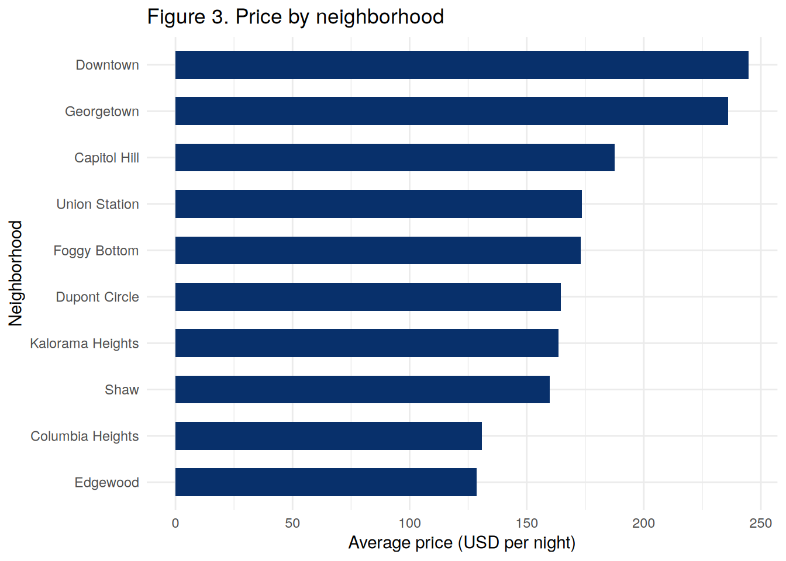
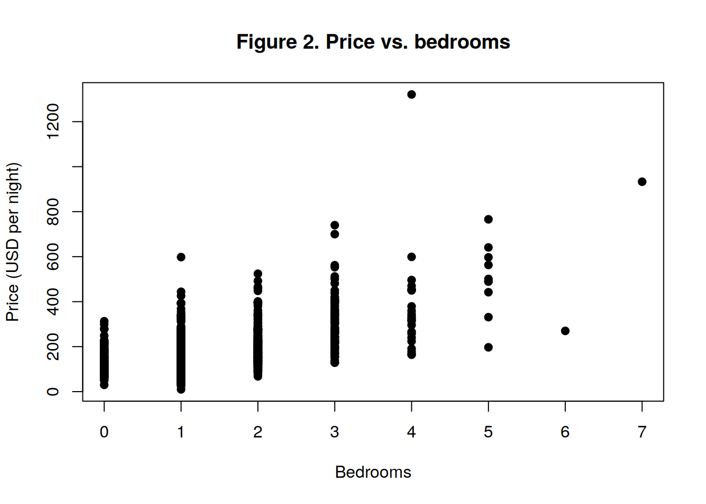

# What Drives Airbnb Prices in Washington, DC

**Courses:** OPAN 6601 Stats for Business Analytics and OPAN 6606 Programming I: Intro to Data, Georgetown MSBA (Fall 2026)
**Group 6:** Kate Smith, Finley Mynott, Pedro Sanchez, Riya Pradhan, Siho Lee
**Tools:** R (base R, dplyr), Quarto
**Methods:** Data joins and cleaning, confidence intervals, hypothesis testing, simple and multiple linear regression, residual diagnostics, multicollinearity

---

## The headline

**Size is by far the strongest driver of a DC Airbnb's nightly price. Each extra bedroom is worth about $48 a night, holding location and room type constant.** Location adds its own premium on top: Downtown or Georgetown is worth roughly $60 to $90 a night more. Superhost status and guest ratings show no consistent link to price once size and location are accounted for.

**Recommendation for an investor:** prioritize larger units (3+ bedrooms) in Downtown, Georgetown or Capitol Hill rather than chasing Superhost status. Those areas also have the widest spread of outcomes, so more upside comes with more variability.

## Data and cleaning

Two files: `Listings.csv` (1,931 listings) and `Reviews.csv` (2,360 rows), stored under different key names (`id` and `listing_id`).

- **Joining.** An inner join and a left join both returned 1,931 rows, so each listing has one review record and the 429 extra review rows matched nothing. We dropped them
- **Missing values.** Found in `beds` (2), `avg_rating` (63) and `room_type` (40). The last ones were blank strings, which `is.na()` doesn't flag because they're coded as `""` rather than `NA`
- **Outliers.** The top price was $50,000 against a median of $146. A |z| > 3 rule flagged two listings, both in Kalorama Heights, both $50,000, both from the same host. We treated them as placeholder prices and removed them. The next-highest price ($1,321) belonged to genuinely large homes, which we kept
- **Feature work.** Parsed free-text bathrooms ("2 shared baths") into a numeric count and a shared/private flag, converted `host_since` to a date, and set the reference levels to the most common values ("Entire home/apt", "Union Station") so coefficients read against a typical listing

**Final dataset: 1,828 listings, no missing values.**

## What the data shows

- **Average nightly price: $168.03** (95% CI $163.77 to $172.30), from our own t-based confidence interval function
- **Is the average above $200?** No. t = -14.70, so we fail to reject. The whole confidence interval sits below $200
- **Is price normal?** No. It's strongly right-skewed: 81.8% of prices fall within one SD (vs. 68.3% expected) and only 98.2% within three (vs. 99.7%). With n = 1,828 the CLT still supports the t-based inference on the mean

| Neighborhood and room type | Avg. price | SD | n |
|---|---|---|---|
| Highest average: Downtown, entire home | $280.56 | $108.73 | 62 |
| Lowest average: Capitol Hill, shared room | $54.33 | $28.82 | 6 |
| Most variable: Georgetown, entire home | $244.90 | $179.93 | 71 |

## Modeling price

**Best single predictor:** bedrooms (R-squared 0.324, residual SE $76.50), then accommodates (0.289) and bath count (0.260). Host and review variables explain almost nothing on their own: Superhost status has an R-squared of 0.001.

**Multiple regression** on size, room type, neighborhood and host/review variables:

| | Simple (bedrooms) | Multiple regression |
|---|---|---|
| R-squared | 0.324 | **0.505** (adj. 0.500) |
| Residual SE | $76.50 | **$65.77** |
| Each extra bedroom | +$65.61 | **+$47.86** |
| Each extra guest capacity | +$27.63 (alone) | +$8.78 |

Key coefficients against Union Station and an entire home:

- **Downtown +$86.69, Georgetown +$63.51**, Foggy Bottom +$33.92, Capitol Hill and Dupont Circle about +$26.75
- **Edgewood -$34.04, Columbia Heights -$31.59**
- **Shared room -$116.70, private room -$31.64**
- **Superhost (p = 0.081) and average rating (p = 0.96): not significant**

The location premium is smaller than the raw neighborhood averages suggest, because bigger units are concentrated in the expensive areas. That inflates the apparent value of location until size is controlled for.

## Checking our own work

- **Assumptions.** Residuals fan out as fitted price rises, and the Q-Q plot bends away in the upper tail. The coefficients stay unbiased, but the standard errors and p-values aren't fully trustworthy. A log transformation of price is the usual fix, and we flagged it
- **Multicollinearity.** Accommodates and bedrooms correlate at r = 0.74. Adding bedrooms cut the accommodates coefficient by two-thirds ($27.63 to $8.78), while bedrooms stayed stable ($65.61 to $47.86). Neither flipped sign, so we kept both, with bedrooms as the stronger driver
- **Variable choices.** Dropped `beds` (the weakest size measure, and overlapping with the others) and `host_total_listings` (dominated by a few hosts with thousands of listings)

## Files

| File | Contents |
|---|---|
| `report/Airbnb_DC_Final_Report_Group6.pdf` | Full report with figures |
| `code/FinalProject_Group6.qmd` | Quarto source (R code and narrative) |
| `images/` | Charts used in this write-up |
