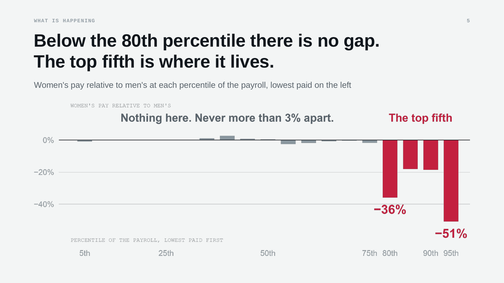
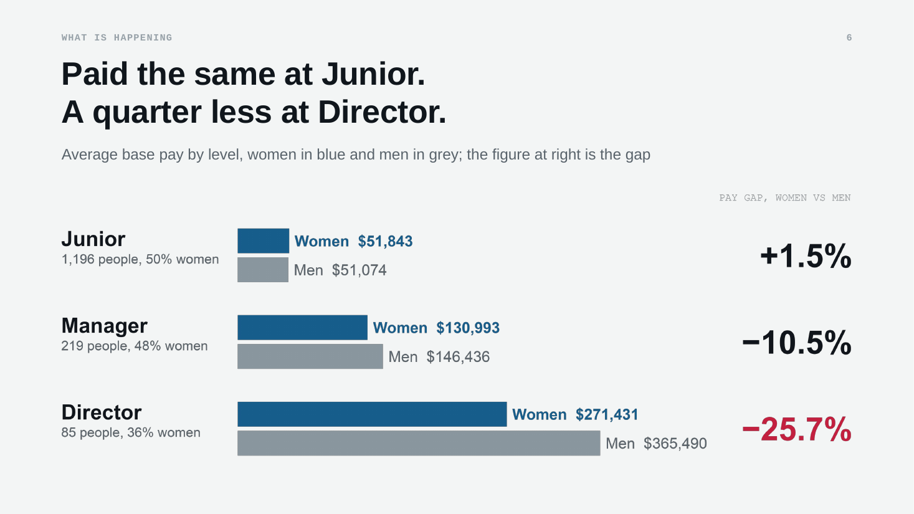
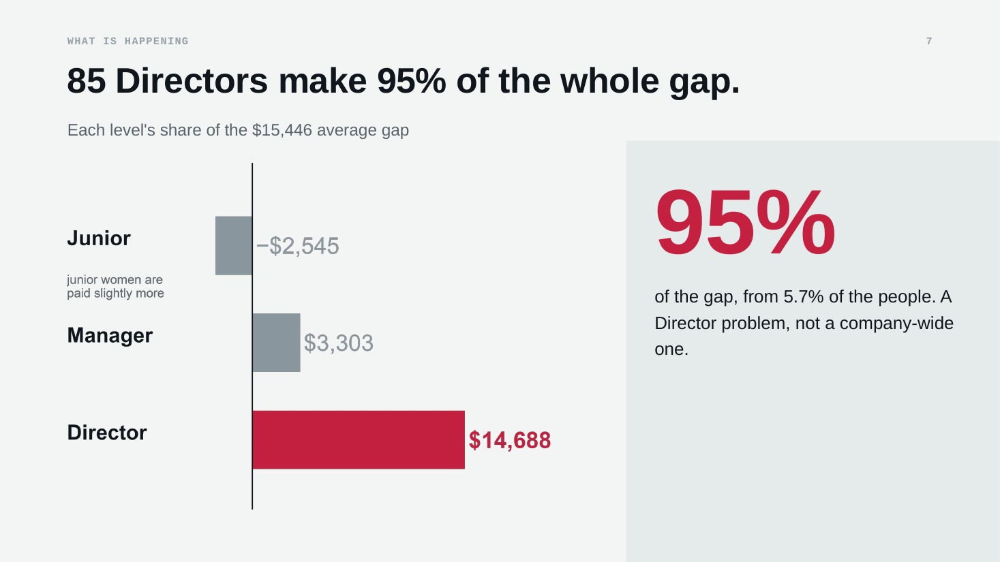
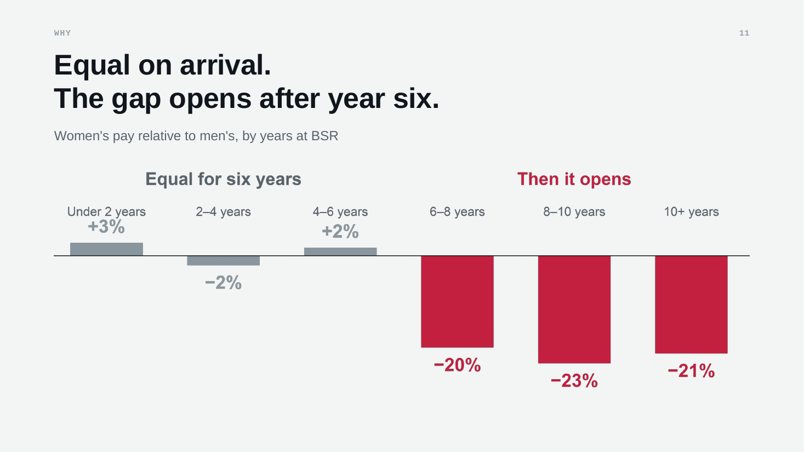
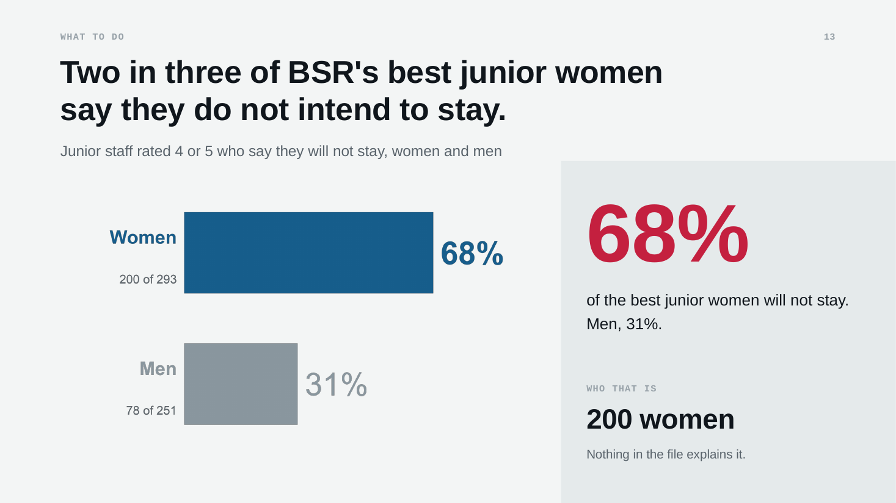

# Pay Equity at BSR: Equal Pay Stops at Director

**Courses:** MGMT 6600 Using Data to Lead Change (Dr. Eliot Sherman) and OPAN 6600 Visualization & Storytelling with Data, Georgetown MSBA (Fall 2026)
**Team 6:** Siho Lee, Finley Mynott, Riya Pradhan, Pedro Sanchez, Kate Smith
**Tools:** Tableau (five-dashboard story with filter actions and parameters), regression analysis, executive memo, slide deck
**Data:** BSR workforce file, 1,500 employees

---

## The headline

**By the measure most pay reviews use, BSR has no gender pay gap: median pay is +0.4% in women's favor. At the mean, women earn $15,446 less, a 17.2% gap.** Both are correct. Pay is equal for four in five employees, and the gap sits almost entirely with 85 Directors.

The bigger risk is coming: **two in three of BSR's best junior women say they don't intend to stay.** They're the pipeline that would close the gap.

We took this to BSR's leadership twice: as an executive memo and deck (MGMT 6600), and as an interactive Tableau story (OPAN 6600).

---

## Part 1: The case for leadership (MGMT 6600)

### Where the gap lives

Below the 80th percentile of the payroll there's no gap: women's and men's pay never differ by more than 3%. The top fifth is where it opens, reaching -51% at the 95th percentile.

| Level | People | Women vs. men |
|---|---|---|
| Junior | 1,196 (50% women) | **+1.5%** |
| Manager | 219 (48% women) | **-10.5%** |
| Director | 85 (36% women) | **-25.7%** |

**85 Directors, 5.7% of the workforce, account for 95% of the company-wide gap.** It's a Director problem, not a company-wide one.

### Why it happens: discretion and segregation

- **Ratings stop paying above Junior.** A Junior rated 5 earns 27% more than one rated 3. At Manager the return is 0%, and at Director it's -1%. Above Junior, pay follows managerial discretion rather than merit
- **Women Directors are rated higher (4.13 vs. 3.98) but paid less.** 71% of women Directors are paid below what BSR's own pay pattern predicts for their job, against 30% of men
- **The best-paid Director jobs are where women aren't.** Only 3 of 30 Accounting and Finance Directors are women. At men's promotion rates BSR would have 52 women Directors, not 31
- **BSR builds the gap, it doesn't hire it.** Entry pay is equal for six years of tenure. After that the gap opens to around -20%

Across 30 robustness models controlling for tenure, location, department, performance, race and parental status, **the unexplained Director gap held at 27.1%.**

### The pipeline risk

Among junior staff rated 4 or 5, **68% of women report low intention to stay, against 31% of men.** Left alone, the junior female bench drops from 50% to under a third, which locks in today's Director gap for a decade and creates about **$5.55M in turnover cost**.

### Two moves we recommended

1. **Close the discretion gap in pay and promotion** (about $4.61M, 3.75% of payroll). Published salary bands for Manager and Director roles, executive sign-off for any out-of-band offer, an annual pay audit against regression models, women on every Director shortlist, and rotation paths into Finance
2. **Calibrate ratings and retain high performers now** (no immediate payroll cost). HR reviews rating spreads by gender before sign-off and flags any manager above 1.5x variance. Skip-level stay conversations with the 200 high-potential junior women within 30 days

---

## Part 2: The Tableau story (Visualization & Storytelling with Data)

We rebuilt the analysis as five Tableau dashboards, one per presenter, each answering the question the last one raised.

1. **The puzzle.** Median salary by gender ($57,070 vs. $56,853) next to the mean ($74,098 vs. $89,544), plus a headcount-by-level chart showing four in five employees are Junior
2. **Junior vs. Director** *(my dashboard)*. Average pay by level and gender, plus a box plot with a level selector parameter
3. **Ratings.** Pay by performance rating, one line per level, showing that pay follows ratings at Junior and nothing above
4. **Job families.** A bubble chart of Director pay against the share of women in each family, with a filter action that drills into one family
5. **Analytical reflections.** Junior leave intention by rating and gender, plus the three recommended actions

### My dashboard: Junior vs. Director

| Level | Women (avg) | Men (avg) |
|---|---|---|
| Junior | $53,371 | $52,547 |
| Manager | $132,513 | $148,464 |
| Director | $278,081 | $372,806 |

The box plot makes the gap visible. At Junior, women's and men's pay boxes sit on top of each other. At Director they don't touch: the top of the women's box is $317,648 and the bottom of the men's is $344,736. **Three quarters of women Directors earn less than three quarters of men Directors.** With only 31 women Directors, I presented it as a strong signal to investigate rather than proof of the cause.

*The memo and the Tableau story were built separately, so a few figures differ slightly. For example, the average Director gap is $94,059 in the memo and $94,725 in the dashboards.*

## Being honest about the limits

- We compared broad levels, not identical jobs, and had base pay only (no bonus or equity)
- 31 women Directors is a small group, though the gap is large at both the median and the mean
- What would change our minds: bonus, equity or job-content data showing that role differences explain the Director gap

## Files

| File | Contents |
|---|---|
| `report/BSR_Leadership_Presentation_MGMT6600.pdf` | 16-slide leadership deck |
| `images/` | Slides used in this write-up |
