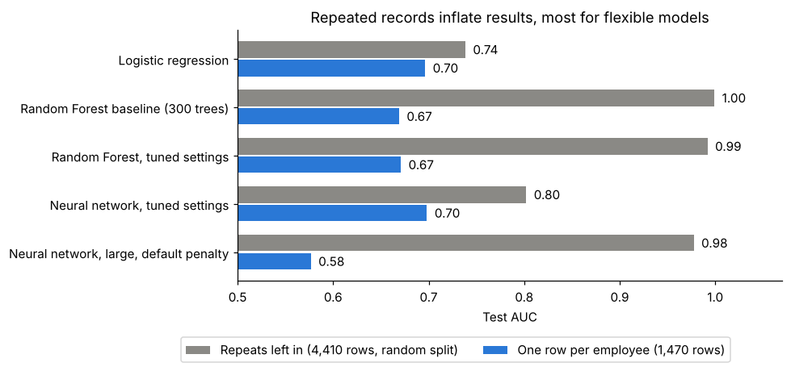
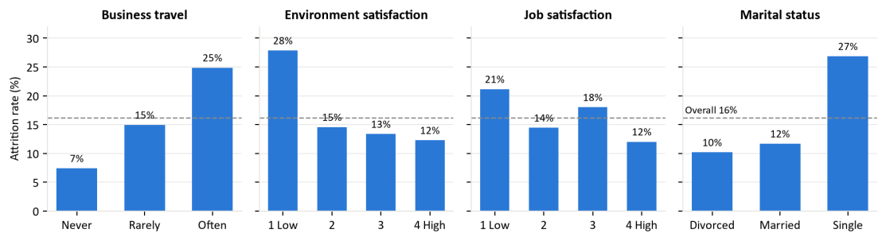
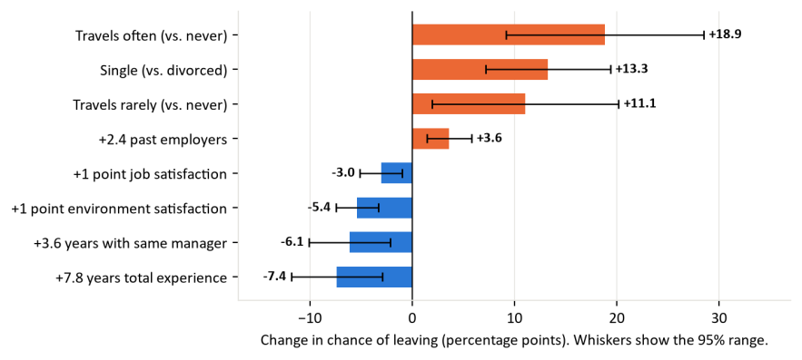
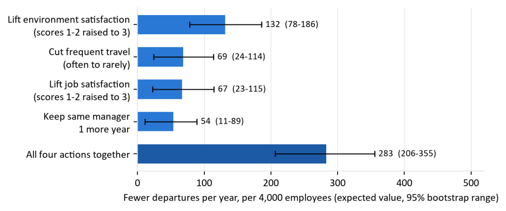
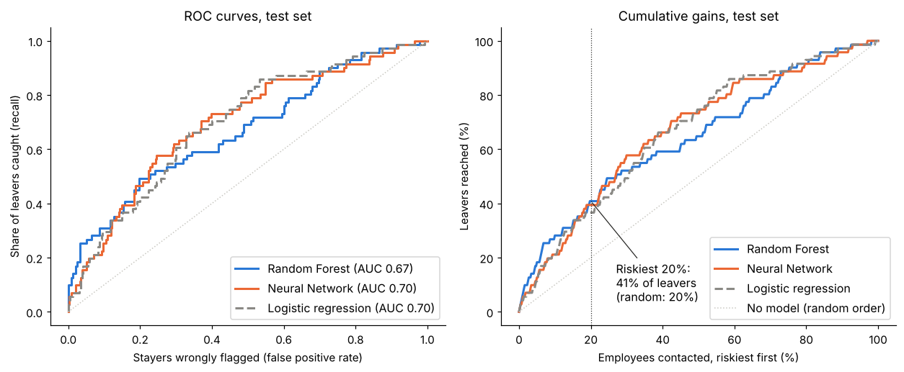
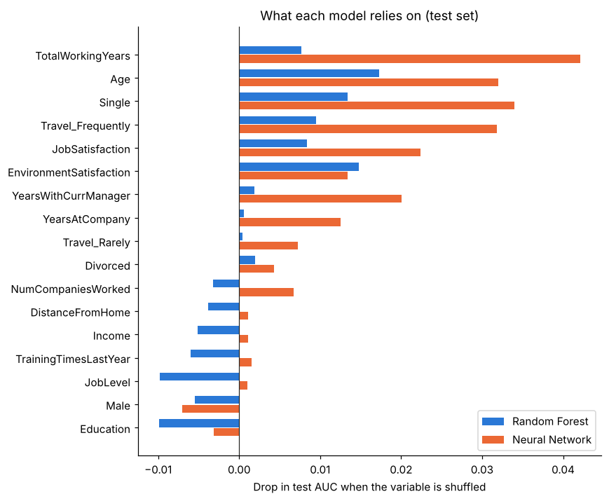

# Keeping Canterra's Talent: Predicting and Explaining Employee Attrition

**Part 1:** OPAN 6602 Machine Learning Foundations, Georgetown MSBA (Fall 2026). Team 6: Finley Mynott, Siho Lee, Riya Pradhan, Pedro Sanchez, Kate Smith
**Part 2:** OPAN 6603 Advanced Machine Learning & AI, Georgetown MSBA (Fall 2026). Pedro Sanchez and Anton van der Laar
**Tools:** Python (pandas, statsmodels, scikit-learn, matplotlib)
**Methods:** Logistic regression, decision trees, KNN, Random Forest, neural networks (MLP), repeated cross-validation, permutation importance, bootstrap scenario analysis

---

## The headline

Canterra replaces about 600 of its 4,000 employees every year. We worked on the problem twice, in two courses:

- **Part 1 (explain it):** four workplace levers could cut attrition from 16% to about 9%, preventing roughly **283 departures and saving about $3.9M a year**. The biggest levers are a poor work environment and frequent travel, not pay.
- **Part 2 (predict it):** a tuned Random Forest puts **41% of all leavers into the riskiest 20% of employees**, twice what a random list would catch. The more important finding was a data problem: duplicated records had made the models look **99% accurate** when they really weren't.

## The data problem we caught first

The HR file had 4,410 records, but **every employee appeared three times** under three different IDs, identical down to income and outcome. With a random split, 91% of test records would have had a copy in the training data, so the models would just be recalling answers they had already seen.

Left in, a default Random Forest scored **99.2% accuracy and caught 95% of leavers**. On employees it had never seen, the same model caught **13%**. The repeats flattered the most flexible models most, and even reversed the ranking: the large neural network looked best with the duplicates and was the weakest model without them.

We kept one row per employee (1,470 employees, 237 leavers) and filled all 73 missing values from each person's copies, so nothing had to be estimated.

---

## Part 1: What drives people out (Machine Learning Foundations)

Our team compared a **logistic regression**, a **decision tree** and a **KNN benchmark**, trained on 70% of employees and tested once on the other 30%. Since only 16% leave, the default 50% cutoff caught just 14% of leavers, so we set each model's cutoff on the training data to favor catching leavers.

| Model | CV AUC | Test AUC | Leavers caught | Flags that were right |
|---|---|---|---|---|
| **Logistic regression** | **0.74** | **0.70** | **63%** | 25% |
| Decision tree | 0.64 | 0.62 | 45% | 24% |
| KNN (benchmark) | 0.73 | 0.68 | 55% | 27% |

We recommended the logistic regression. It ranks risk best, and it states each driver's effect in plain terms, which is what management actually needed.

- **Frequent travel:** frequent travelers are 19 percentage points more likely to leave than non-travelers
- **Work environment:** each extra satisfaction point cuts the odds of leaving by 35%
- **Job satisfaction:** each extra point cuts the odds by 21%
- **Manager stability:** each extra year with the same manager cuts the odds by 14%
- **Not significant:** pay, job level, education, age, gender and commute distance

### Recommendations and what they're worth

| Action | Owner | Departures prevented per year* |
|---|---|---|
| 1. Fix low-scoring work environments | HR, Facilities | 132 (78 to 186) |
| 2. Cap and rotate frequent travel | Department heads | 69 (24 to 114) |
| 3. Act on low job satisfaction | Line managers | 67 (23 to 115) |
| 4. Keep manager assignments stable | Senior leaders | 54 (11 to 89) |
| 5. Monthly top-10% risk list | HR analytics | Targets actions 1 to 4 |

*Per 4,000 employees, 95% bootstrap range from 1,000 refits.

---

## Part 2: Can HR see departures coming? (Advanced ML & AI)

In Advanced ML, Anton and I came back to the same problem with two more flexible models, a **Random Forest** and a **neural network**. We asked whether they could flag leavers better, and what that costs in explainability.

### Tuning

Every setting was chosen by 5-fold cross-validation repeated three times, on training employees only.

| | Random Forest | Neural network |
|---|---|---|
| **Search** | Predictors per split (1 to 17) x leaf size (1 to 20): 35 combinations, then depth, class weights and number of trees | Network shape (1 to 3 layers, 4 to 32 nodes) x penalty (0.0001 to 10): 49 combinations, then activation, optimizer, learning rate and early stopping (75 more) |
| **Final model** | 300 fully grown trees, 1 predictor per split, minimum leaf size 3 | One hidden layer of 32 nodes (ReLU), penalty 1.5, Adam |
| **CV AUC** | 0.724 default, **0.753 tuned** | 0.703 default, **0.743 tuned** |
| **Main lesson** | Variety between trees mattered most. AUC fell from 0.75 to 0.71 as trees were allowed more predictors per split | Restraint mattered most. Only a penalty about 15,000x the default stopped the network memorizing, and extra layers added nothing |

### Results on 441 employees the models never saw

| Measure | Random Forest | Neural network | Logistic regression | No model |
|---|---|---|---|---|
| Test AUC | 0.671 | 0.698 | 0.696 | 0.500 |
| Average precision | **0.385** | 0.331 | 0.320 | 0.161 |
| Brier score (lower is better) | **0.124** | 0.127 | 0.129 | 0.135 |
| Leavers in riskiest 10% (44 people) | **20** | 15 | 15 | about 7 |
| Leavers in riskiest 20% (88 people) | **29 (41%)** | 28 (39%) | 26 (37%) | about 14 (20%) |

**We recommended the Random Forest for a pilot, on practical grounds rather than accuracy.** The 95% interval for the AUC difference runs from -0.08 to +0.02, so the test set can't separate the two models. The forest finds more leavers at the top of the list, where HR would actually act. Its probabilities had the lower error, and they were well calibrated: for the riskiest fifth it predicted 31% attrition, and 33% actually left. It also works close to its defaults, while the network quietly falls apart if the penalty is wrong (0.58 AUC at the default setting).

**The honest caveat:** neither model beat a plain logistic regression. What limits accuracy is the information in these 17 fields, not the choice of algorithm.

### What each model relies on

We used a shuffle (permutation) test rather than the forest's built-in importance. The built-in measure ranked income and distance from home in the top five, but shuffling them didn't lower test AUC at all: that measure favors fields with many distinct values. Both models lean on the same signals:

- **New employees:** 35% of people in their first two years left, against about 11% from year five on
- **Frequent travel:** 26% left, against 15% of occasional travelers and 8% of non-travelers
- **Single employees:** 27%, against 11% of married and divorced employees
- **"Low" work environment rating:** 27% left; every other rating sits at 12% to 14%
- **Little predictive value:** income, job level, education, gender, distance from home and training

We also checked whether a new manager matters separately from being new. It mostly doesn't: high attrition follows short tenure at Canterra, whoever the manager is.

### Recommendations (Part 2)

1. **Fix the HR extract first** and confirm why every employee appears three times
2. **Pilot the Random Forest as a ranking tool, with people in the loop.** Reviewing the riskiest 20% (about 800 people) could reach about 245 of the 600 expected departures, against 120 for a random list. Two in three people on that list would have stayed anyway, so it should drive stay interviews and career conversations, never adverse decisions
3. **Concentrate on the first two years:** structured onboarding, a mentor, and check-ins at 6, 12 and 18 months
4. **Review the load on frequent travelers** and follow up "low" work environment ratings quickly
5. **Decide how personal characteristics are used.** A model without age, gender and marital status loses about 0.03 AUC. HR and legal should choose which version to run
6. **Measure what works:** run the pilot against a comparison group and keep logistic regression as a benchmark

## Limitations we were upfront about

- One year of data on 1,470 employees and one test split of 441, so every AUC carries a margin of about +/-0.07
- The patterns are associations, not causes, which is why both plans start with a controlled pilot
- The file doesn't separate resignations from dismissals or retirements

## Files

| File | Contents |
|---|---|
| `report/Canterra_Attrition_Report_Team6.pdf` | Part 1 report for Canterra's management team |
| `report/Canterra_Attrition_RF_vs_NN_Report.pdf` | Part 2 report: Random Forest vs. neural network |
| `code/advanced_ml_rf_vs_neural_network.ipynb` | Part 2 notebook (tuning, testing, permutation importance) |
| `images/` | Charts used in this write-up |

*AI use: Claude was used as a coding reference and to help prepare deliverables. All code and results were reviewed and verified by the team.*
