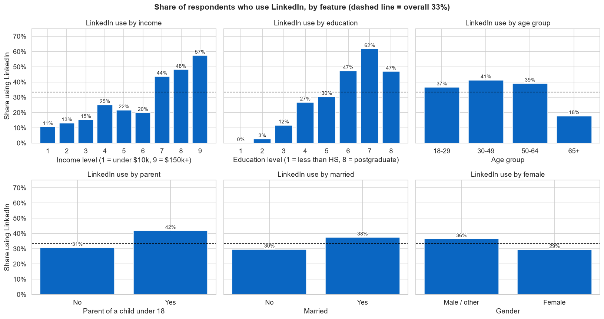
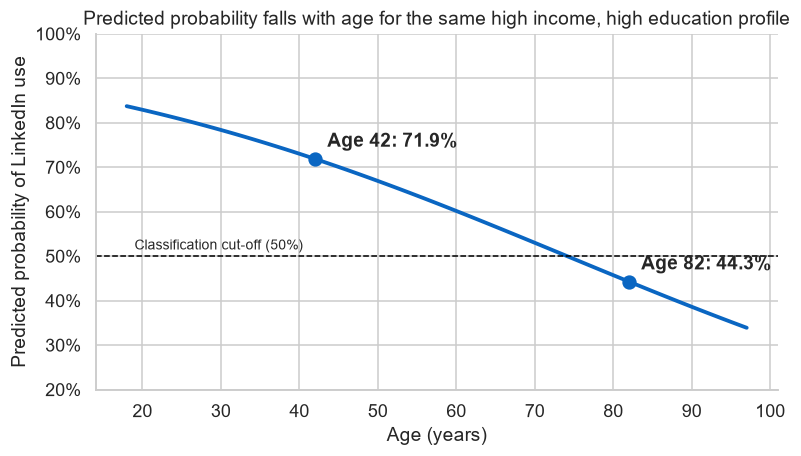

# Who Uses LinkedIn? A Demographic Predictor with a Live App

**Course:** OPAN 6607 Programming II: Data Infrastructure, Georgetown MSBA (Fall 2026)
**Team:** Muhammad Faateh Awan, Jack Hamilton, Siho Lee, Pedro Sanchez, Tina Chen
**Tools:** Python (pandas, NumPy, scikit-learn, matplotlib, seaborn), Streamlit, GitHub
**Methods:** Survey data cleaning, exploratory analysis, logistic regression with balanced class weights, confusion matrix, precision/recall/F1

**[Try the live app](https://linkedin-predictor-msba-group11.streamlit.app/)** | **[App source code](https://github.com/ma2800-enigma/linkedin-predictor)**

---

## The headline

A marketing team deciding where to spend its campaign budget asked a simple question: **who actually uses LinkedIn?** We built a logistic regression on six demographic features from a Pew Research survey, then deployed it as a **Streamlit web app** where anyone can enter a profile and get a predicted probability.

**LinkedIn users are more educated, higher-earning and of working age.** The model finds about two in three real users, and half the people it flags are users, compared with one in three if you picked at random.

## Data and cleaning

The raw Pew survey has **1,502 respondents and 89 columns**. We kept seven: the target (uses LinkedIn) and six features (income, education, parent, married, female, age).

- Wrote a `clean_sm()` helper with `np.where` to recode answers into clean 0/1 flags, and tested it on a toy dataframe first
- Treated codes above each valid range as missing (income above 9, education above 8, age 98 = "don't know")
- **A judgment call:** we also dropped "Don't know" and "Refused" answers for parent, marital status and gender, because refusing to answer isn't the same as saying no. That cost only 10 rows
- **Final dataset: 1,250 people, 33% of them LinkedIn users**

## What the exploration showed

- **Education is the strongest signal.** 12% of high school graduates use LinkedIn, against 47% of bachelor's and postgraduate degree holders. Almost no one without a high school diploma does
- **Income works the same way.** 11% in the lowest income group, 57% in the highest, with a clear jump once household income passes $75k
- **Age matters mostly after 65.** Use is flat at 37% to 41% from 18 to 64, then falls to 18%
- **Parent, married and gender matter much less** (a few points each)

## The model

A logistic regression with `class_weight="balanced"`, trained on 80% of respondents and tested on the other 250. Without the balancing, the model could hit 67% accuracy by calling everyone a non-user, which would be useless for marketing.

| Metric | Value | What it means for the marketing team |
|---|---|---|
| Accuracy | 70.4% | 176 of 250 test people classified correctly |
| Recall | 0.655 | Finds about two in three real LinkedIn users |
| Precision | 0.550 | About half the people it flags are real users |
| F1 | 0.598 | Balances the two |

We calculated precision, recall and F1 by hand from the confusion matrix (121 TN, 45 FP, 29 FN, 55 TP) and confirmed they match scikit-learn's `classification_report`.

**Coefficients, as odds ratios:** each step up in education multiplies the odds of using LinkedIn by about 1.38, and each step up in income by about 1.32. Married flips negative once income is in the model: married households report higher income, so marriage itself adds nothing.

**Scoring example:** a 42-year-old, high-income, highly educated married woman has a **71.9%** predicted probability of using LinkedIn. The same profile at 82 drops to **44.3%**, crossing the 50% cutoff at around age 74.

## Recommendations for the marketing team

- Use LinkedIn for campaigns aimed at **college-educated professionals with household income above $75k, aged roughly 25 to 64**
- Pick the metric to match the campaign: **precision** for a small paid campaign where every wrong target is wasted money, **recall** for a cheap, broad awareness push
- Read the probabilities as relative scores. Balanced class weights push them above the true rate, so they're good for ranking and yes/no calls, but 71.9% doesn't mean 72 in 100 people like that use LinkedIn

## Files

| File | Contents |
|---|---|
| `report/LinkedIn_Predictor_Notebook.html` | Full analysis notebook (open in a browser) |
| `images/` | Charts used in this write-up |
| [Live app](https://linkedin-predictor-msba-group11.streamlit.app/) | Streamlit app powered by the same model |
| [App repo](https://github.com/ma2800-enigma/linkedin-predictor) | Source code for the deployed app |
