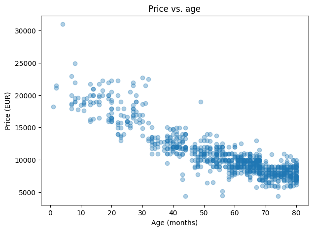
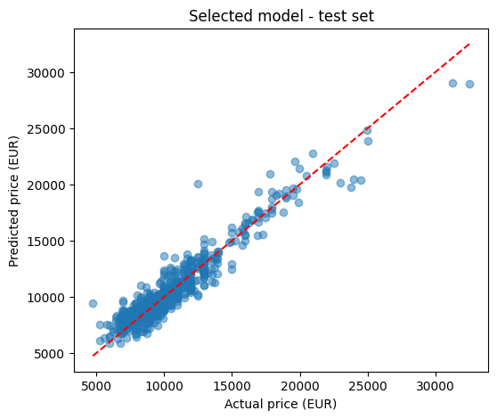

# What Drives the Resale Value of a Used Toyota Corolla

**Course:** OPAN 6602 Machine Learning Foundations, Georgetown MSBA (Fall 2026)
**Team:** Pedro Sanchez and Anton van der Laar
**Tools:** Python (pandas, statsmodels, scikit-learn, matplotlib)
**Methods:** Multiple linear regression, residual diagnostics, Cook's distance, VIF, forward/backward/stepwise selection, non-linear terms

---

## The headline

**Our final model explains 91% of the variation in resale price on cars it had never seen, with a typical miss of about EUR 786.** We turned it into a one-page pricing guide that a salesperson can use on the floor to anchor a trade-in offer.

## The business problem

A dealership running a trade-in promotion needs to estimate what a used Corolla will resell for *before* making an offer. Offer too much and the margin disappears. Offer too little and the customer walks. They asked us for two things:

1. A practical price estimate
2. A clear list of the specifications that should actually change the offer, and the ones that shouldn't

## Data

1,436 past Corolla sales, with price, age, mileage, engine size, horsepower, fuel type, weight, road tax, guarantees and a long list of optional extras. We built the model on 60% of the sales and tested it on the other 40%, so every accuracy figure below comes from cars the model hadn't seen.

## Approach

**1. Baseline model.** A multiple regression on the required set of specifications. Test R-squared was already 0.882, with an average miss of EUR 890.

**2. Diagnostics.** Residual plots showed a slight curve and wider misses at higher prices. Cook's distance flagged a handful of extreme records.

**3. Cleaning, with a rule.** We removed three records with a real data problem, including a car listed with an impossible 16,000 cc engine. That single value had been distorting the engine coefficients. We **didn't** remove the expensive Corolla Versos just because the model missed them: there were several of them with consistent specs, and deleting only the awkward ones would have been cherry-picking.

**4. Trying alternatives one change at a time.** We ran forward, backward and stepwise selection as a check, then built our own three models, adding one change each time to see what it bought:

| Model | What changed | Test RMSE |
|---|---|---|
| Baseline | Required predictors | EUR 1,219 |
| Cleaned baseline | Three bad records removed | EUR 1,178 |
| Model A | + Weight, BOVAG guarantee | EUR 1,150 |
| **Model B (selected)** | **+ Age squared** | **EUR 1,075** |
| Model C | + Age x mileage interaction | EUR 1,076 |

Adding **age squared** made the biggest single difference. Cars lose value fastest when they're new, and a straight line can't capture that. Model C fit the training data slightly better but did a little worse on the test set, so it didn't earn the extra complexity.

## Results

| Performance on unseen cars | |
|---|---|
| Share of price variation explained (R-squared) | **91%** |
| Typical absolute miss (MAE) | **about EUR 786** |
| Cars estimated within EUR 1,000 | **71 out of 100** |
| Cars estimated within EUR 1,500 | **87 out of 100** |

### What actually drives the price

- **Age comes first.** At one year old, an extra month costs about EUR 170 in resale value. By six years old it's closer to EUR 68.
- **Mileage is next.** Each extra 10,000 km takes about EUR 160 off, holding everything else fixed.
- **Automatic climate control is the standout option**, worth about EUR 2,170. Ordinary air conditioning is worth about EUR 390 and powered windows about EUR 270.
- **Guarantees matter.** A BOVAG guarantee adds about EUR 520 and a manufacturer guarantee about EUR 240.
- **What doesn't matter:** a CD player, a sport badge, a tow bar and automatic transmission showed no reliable premium once the rest of the car was accounted for.
- **The engine package should be read as one block.** Horsepower, weight, fuel type and road tax overlap heavily, so they tell you whether a car is a higher- or lower-value version. They shouldn't be added up as separate option prices.

## From model to the sales floor

The deliverable was a one-page guide written for salespeople, not analysts. It includes a quick-reference grid of estimated prices by age and mileage, a list of what to add for each option, and a worked example:

> A four-year-old Corolla with 90,000 km starts at about EUR 10,730. Add automatic climate control and a BOVAG guarantee (about EUR 2,700 together) and the paperwork-based estimate is around EUR 13,400, before the physical inspection.

Because the typical miss is about EUR 786, we told the dealership to think in a price band and to treat the estimate as a ceiling for cars in worse-than-average condition. The model can't see dents, worn tyres or a missing service book.

## Files

| File | Contents |
|---|---|
| `code/corolla_resale_price_model.ipynb` | Full analysis notebook |
| `report/Corolla_Resale_Value_Report.pdf` | Two-page report for the dealership |
| `images/` | Charts used in this write-up |
