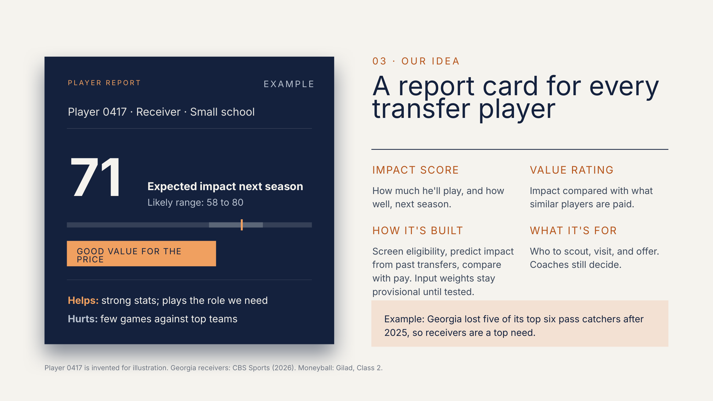
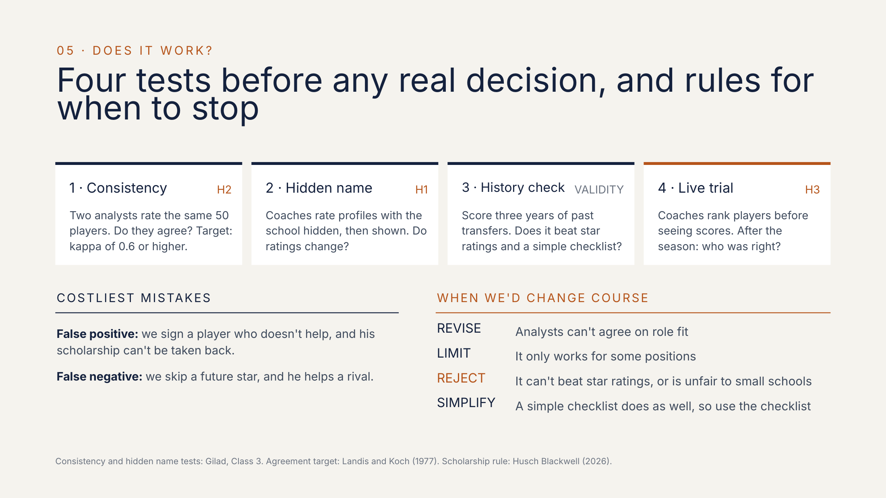

# A Report Card for the College Football Transfer Portal

**Course:** MGMT 6601 Collaborative Intelligence, Georgetown MSBA (Fall 2026)
**Team 6:** Finley Mynott, Siho Lee, Riya Pradhan, Pedro Sanchez, Kate Smith
**Focus:** Human-AI decision design, sports analytics, model validation, responsible AI
**Deliverable:** Six-minute pitch to a mock college football leadership team

---

## The headline

We designed a **"credit score for recruits"**: one report card for every transfer portal player a team considers. It predicts how much he'll help next season, shows how confident that prediction is, and compares it with what he'll cost. Coaches still make every call. The model's job is to make sure overlooked players at small schools get a fair look and the budget goes further.

## The decision

The transfer portal is the list of college players who want to switch schools, and teams get only a few weeks to choose. Using the University of Georgia as a running example: there's no general manager, so every recruiting and pay decision runs through the head coach. Today, staff filter a long list by star ratings and highlight videos.

Picture one open roster spot and a tight budget. One player comes from a famous program, the other from a small school nobody watches. Who do you pick?

## The problem *(my section of the pitch)*

**What we know:**
- **Ratings are noisy.** After more film review, 247Sports moved Georgia's transfer class from 32nd to 19th
- **Results vary.** Teams that leaned hardest on transfers averaged about 1.4 fewer wins. Weaker teams may simply use more transfers, though, so we didn't claim cause

**What we suspected, framed as testable hypotheses:**
- **H1, bias:** coaches overrate famous names
- **H2, noise:** different staff rate the same player differently
- **H3, one voice:** everything filters through the head coach

**Why now:** the new federal rules our pitch was built around limit players to one free transfer, cap spending and stop scholarships being pulled for poor play. Every signing becomes a long commitment, so mistakes cost more.

## What we'd build

Each player gets a report card with:

- **An overall score** (for example 71): the predicted contribution next season
- **A confidence range** (for example 58 to 80): less data means a wider range
- **A value view:** if two players would help equally and one costs half as much, he's the better buy. That's the Moneyball logic for a capped budget

The score uses four inputs. **Direct measures:** playing time, speed and size. **Proxies, each with a check:**
- **Past performance**, adjusted for opponent strength. A receiver's big numbers might really belong to his quarterback or a weak schedule
- **Role fit**, scored by two raters who have to agree

Data comes from game stats, verified testing, film and disclosed pay deals. **Injury history is never scored.** It only triggers a medical review.

## How we'd prove it works

Four tests, each tied to one of the suspicions:

1. **Noise:** two analysts rate the same 50 players. Do they agree?
2. **Bias:** coaches rate profiles with the school name hidden, then shown. If ratings jump for a big name, that's bias
3. **History check:** score three years of past transfers. Does the model beat star ratings and a simple checklist?
4. **Live trial:** coaches rank players before seeing scores, and after the season we see who was right

**The two kinds of error don't cost the same.** A false positive means signing a player who doesn't help, on a scholarship that can't be taken back. A false negative means passing on a future star who then helps a rival.

**Stop rules set in advance:**
- If analysts can't agree on role fit, we revise the inputs
- If it only works for some positions, we limit it to those
- If it can't beat star ratings, or it's unfair to small schools, we reject it
- If a simple checklist works as well, we use the checklist

## Using it responsibly

- **Coaches decide; the algorithm advises.** Position coaches judge character and fit, compliance confirms pay is fair market value, and the head coach makes every final call
- **The biggest risk is underpaying players because of flawed data.** So injury history never lowers a score, a player without a score gets human review rather than an automatic no, and the model never sets a maximum offer
- **Accuracy is checked separately** for small and large schools
- **Players can correct the facts** behind their rating

## My individual work in this course

Three short pieces that fed into the team project:

- **Moneyball analysis.** What problem Billy Beane was really solving (pricing, not scouting), which scout knowledge was legitimate and which was "appearance dressed up as expertise", and why better data wasn't enough. The lesson I took: the analysis was right and sitting in the building, but it changed nothing until the person holding the lineup card was convinced. I applied it to hiring: grade interviewers on how their picks actually perform, the way you'd grade scouts
- **Noise vs. bias.** Bias leans one way and shows up in averages. Noise is scatter, and it hides because each case lands on one desk. In Kahneman's audits, executives expected 5% to 10% disagreement and found 48% to 60%. I designed a structured internal-promotion process: criteria written before the role is posted, independent scoring by three raters, a noise audit as a baseline, and the evidence I'd need before trusting it, since **a consistent tool can still be consistently wrong**
- **Decision opportunities.** Three candidates for human-AI collaboration: client credit terms at a family logistics company, squad selection in competitive sport, and food planning at a soup kitchen. The second became our team project. For credit terms, I argued AI helps most with *representation*: seeing clients through shipment volumes and payment timing rather than a name, a revenue figure and a gut feeling

## What I took from it

The most useful part of this project wasn't the scoring model. It was deciding in advance what evidence would make us drop it. A tool like this can easily become a way to justify decisions coaches have already made. Writing the stop rules first, and committing to a plain checklist if it did just as well, kept the focus on whether it actually improves decisions.

## Files

| Folder | Contents |
|---|---|
| `report/Transfer_Portal_Pitch_Team6.pdf` | Pitch deck |
| `report/individual/` | My Moneyball, Noise vs. Bias and Decision Opportunities write-ups |
| `images/` | Slides used in this write-up |
